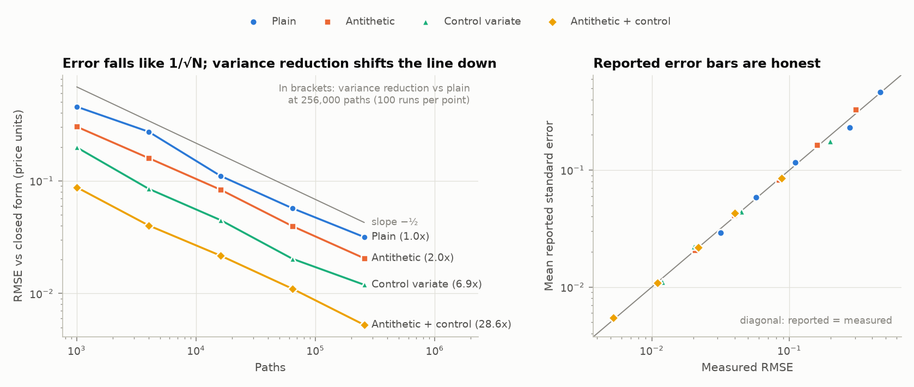
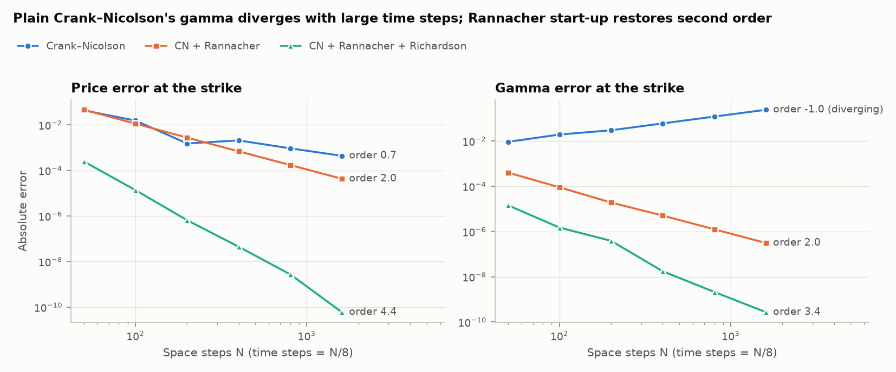
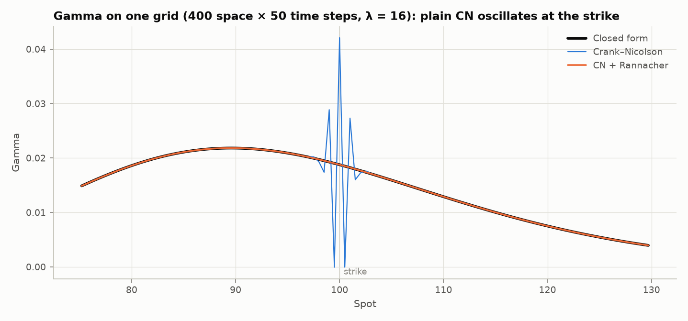
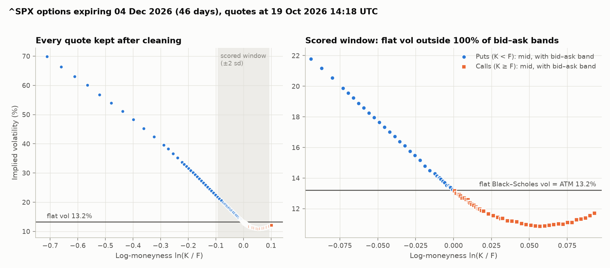

# Option Pricing Lab

European options priced three independent ways (closed-form Black–Scholes, Monte Carlo, and a Crank–Nicolson solver for the heat equation the Black–Scholes PDE reduces to), cross-checked against each other, then confronted with S&P 500 option quotes to measure where the model breaks.

## Results

Every number below is written by `python scripts/reproduce.py --update-readme` from a run of the code in this repository. Nothing in this block is typed by hand.

<!-- results:start -->
Benchmark contract: European call, S = K = 100, T = 1 y, r = 5%, σ = 20%, q = 0%. Closed-form price 10.4506.

| Method | Setting | Error vs closed form | Measured convergence order | Time per price |
| --- | --- | --- | --- | --- |
| Monte Carlo, plain (baseline) | 256,000 paths | RMSE 0.0317; variance ÷1.0 | 0.50 (theory 0.5) | 3.0 ms |
| Monte Carlo, antithetic + control variate | 256,000 paths | RMSE 0.0053; variance ÷28.6 | 0.50 (theory 0.5) | 2.3 ms |
| Crank–Nicolson, plain (baseline) | 1600 × 200 grid | price 4.4e-04; gamma 2.4e-01 | price 0.7; gamma -1.0 (diverging) | 4.5 ms |
| Crank–Nicolson + Rannacher start-up | 1600 × 200 grid | price 4.3e-05; gamma 3.1e-07 | price 2.0; gamma 2.0 | 4.2 ms |
| + Richardson extrapolation | 1600 × 200 grid and 2× finer | price 6.0e-11; gamma 2.7e-10 | price 4.4; gamma 3.4 | 17.8 ms |

Cross-check on 400 random contracts (calls and puts; strikes 70–130% of spot, maturities 0.1–2 y, vols 10–60%, rates −1% to 6%, dividend yields 0–4%):

| Check | Result |
| --- | --- |
| PDE pricer at default settings: max / median absolute error | 9.6e-08 / 2.6e-08 (3.8 ms per price) |
| Monte Carlo (200,000 paths): 99% intervals containing the closed form | 98.5% (3 degenerate runs with zero error bars; max error there 3.0e-06) |
| Closed form | 18 µs per price |

Market test: ^SPX (SPXW) options expiring 2026-12-04, quotes at 2026-10-19 14:18 UTC (46 days to expiry).

| Market test | Result |
| --- | --- |
| Quotes used / downloaded | 111 / 176 |
| Forward from put–call parity; implied rate | 7745.20; 2.96% |
| At-the-money implied vol | 13.21% |
| Flat-vol error vs market within ±2 sd (RMSE / max) | 2.90 / 8.58 vol points |
| Quotes whose bid–ask band excludes the flat vol | 100% of 77 |
| Implied vol at −2 sd / +2 sd | 21.79% / 11.73% |

Timings: arm, Python 3.13.5, generated 2026-10-19 UTC.
<!-- results:end -->

Baselines are plain Monte Carlo and plain Crank–Nicolson; the "final" methods are the variance-reduced estimator and the Rannacher + Richardson solver. Full tables, including every grid and path count, are in [`results/summary.md`](results/summary.md).









## The problem and why it matters

A derivatives desk will not trust a pricer until it has been checked against an independent method, and every pricer has failure modes that only show up under particular settings. This project builds three pricers that must agree where theory says they should, measures how fast each converges and where each fails, and then uses market prices to measure how wrong the model itself is: Black–Scholes assumes one volatility for every strike, and the market disagrees.

## Data

- **Source:** S&P 500 index options (ticker `^SPX`, PM-settled `SPXW` contracts), one expiry about 45 days out, from Yahoo Finance via [yfinance](https://github.com/ranaroussi/yfinance).
- **Terms:** yfinance is Apache-2.0 licensed. Yahoo's data is for personal use only, so `scripts/download_chain.py` downloads it to `data/` (ignored by git) and only derived figures and summary statistics are published here.
- **Snapshot:** one point-in-time chain; its file name and quote time are listed in [`results/summary.md`](results/summary.md).
- **Known flaws:** quotes are delayed about 15 minutes and are not synchronous across strikes; outside US trading hours Yahoo may show stale or zero bids and asks; far out-of-the-money strikes have wide spreads. The cleaning steps and how many quotes each removes are reported in the summary.
- **Interest rate and dividends:** not downloaded. The forward price and discount factor are implied from put–call parity on the same quotes (see Approach).

## Approach

**Closed form** ([`black_scholes.py`](src/optlab/black_scholes.py)). Black–Scholes–Merton prices and Greeks with a continuous dividend yield, vectorised. It is the benchmark: under the model's assumptions it is exact, so every numerical error is measurable. [Notes](docs/notes/01-black-scholes.md).

**Monte Carlo** ([`monte_carlo.py`](src/optlab/monte_carlo.py)). A European payoff depends only on the terminal price, which has an exact formula under geometric Brownian motion, so there is no time-stepping bias. Four estimators: plain, antithetic variates, a control variate (the discounted terminal price, whose mean is known), and both combined. Each reports a standard error, and the tests check that its confidence intervals cover the true price at the stated rate. [Notes](docs/notes/02-monte-carlo.md).

**Finite differences** ([`finite_difference.py`](src/optlab/finite_difference.py)). The Black–Scholes PDE is transformed into the heat equation u_τ = u_xx and solved with Crank–Nicolson, using a banded Cholesky factorisation. Plain Crank–Nicolson mishandles the kink in the payoff when time steps are large, so the solver uses Rannacher start-up (two initial steps replaced by fully implicit half-steps), then Richardson extrapolation across two grids to cancel the leading error term. [Notes](docs/notes/03-crank-nicolson.md).

**Implied volatility and the smile** ([`implied_vol.py`](src/optlab/implied_vol.py), [`smile.py`](src/optlab/smile.py)). Brent's method inverts Black–Scholes for the vol. From the raw chain: keep one settlement root, drop quotes without a two-sided market or with spreads over 25% of the mid, imply the forward and discount factor by a robust (Theil–Sen) fit of put–call parity, keep out-of-the-money options, and solve for implied vol at the bid, mid and ask. [Notes](docs/notes/04-implied-vol-and-smile.md).

Design choices and the alternatives considered are logged in [`docs/decisions.md`](docs/decisions.md).

## Evaluation and error analysis

**Numerical methods.** The benchmark is the closed form. Monte Carlo is judged on its root-mean-square error over 100 independent runs per path count, on whether its reported standard error matches that measured error, and on variance reduction at an equal path count. The PDE solver is judged on price, delta and gamma errors at the strike, where the payoff kink makes Greeks hardest, as the grid is refined with time steps set to one-eighth of the space steps. Convergence orders are least-squares slopes on log-log axes. A second check prices 400 random contracts across the validated parameter range with all three methods.

**What the figures should show.** Monte Carlo error falls like 1/√N for every estimator, with variance reduction shifting the line down rather than changing its slope. Plain Crank–Nicolson's gamma at the strike gets *worse* as the grid is refined, because its amplification factor for high-frequency error tends to −1 when Δτ/Δx² is large. Rannacher start-up restores second order. With Richardson extrapolation the order rises to about four.

**Market test.** The benchmark is one flat Black–Scholes vol for the whole expiry, set at the at-the-money level. Its error is measured in vol points within ±2 standard deviations of the forward, together with the share of quotes whose bid–ask range excludes that flat vol. That share separates real model error from quote noise: if the flat vol sits inside most bid–ask bands, the smile could be noise.

_Interpretation of the market run: to be written after the first snapshot is analysed._

**Why trust these numbers?** The test suite (`pytest`) checks each pricer against references that do not share its code: textbook values, numerical integration of the risk-neutral expectation, model-free no-arbitrage relations, and confidence-interval coverage. The market pipeline is tested on synthetic chains with planted bad quotes and a known smile, which it must recover. To test the tests, `python scripts/mutation_check.py` injects deliberate bugs (a wrong dividend sign, a missing Itô term, misweighted boundary terms, an understated standard error, a daylight-saving error, and more) into a temporary copy of the code and checks that the suite fails for every one.

## How to reproduce

Requires Python 3.12 or newer and an internet connection for the market data step.

```bash
python -m venv .venv
source .venv/bin/activate              # Windows: .venv\Scripts\activate
pip install -r requirements.txt
python scripts/reproduce.py --update-readme
```

This runs the tests, the numerical studies (about a minute on a laptop), downloads one option chain if none is saved, and writes `results/`. Later runs reuse the saved snapshot so results stay fixed; pass `--fresh` to download a new one, or `--skip-market` to run offline. Download the chain while US markets are open (09:30–16:00 New York time), as Yahoo may show zero bids and asks otherwise.

Price a single option all three ways:

```bash
python scripts/price.py --spot 100 --strike 110 --maturity 1 --rate 0.04 --vol 0.25 --div-yield 0.01 --type put
```

## Project structure

```
option-pricing-lab/
├── configs/default.toml        # every study parameter and seed
├── scripts/
│   ├── reproduce.py            # one command: tests, studies, figures, README results
│   ├── download_chain.py       # save one option chain snapshot
│   └── price.py                # price one option three ways
├── src/optlab/
│   ├── black_scholes.py        # closed-form prices and Greeks
│   ├── monte_carlo.py          # Monte Carlo with variance reduction
│   ├── finite_difference.py    # Crank–Nicolson, Rannacher, Richardson
│   ├── implied_vol.py          # Brent implied vol
│   ├── market_data.py          # Yahoo snapshot download and storage
│   ├── smile.py                # cleaning, parity forward, smile metrics
│   ├── studies.py              # convergence and accuracy studies
│   ├── plots.py                # figures
│   └── report.py               # metrics.json, summary.md, README block
├── tests/                      # pytest suite, including synthetic option chains
├── results/                    # figures and metrics written by reproduce.py
├── docs/
│   ├── scope.md                # problem, metrics, plan
│   ├── decisions.md            # decisions log
│   └── notes/                  # maths notes, one per method
├── pyproject.toml
└── requirements.txt            # pinned dependencies
```

## Limitations and what would break this

- **The model, by design.** Black–Scholes assumes constant volatility, no jumps, and frictionless continuous hedging. The three pricers agree with each other because they solve the same wrong model; the market test measures how wrong it is.
- **One snapshot, one expiry.** The smile is measured once. Another day, a stressed market or a short-dated expiry could look different; a full volatility surface across expiries and dates is the natural extension.
- **Quote quality.** Delayed, non-synchronous Yahoo quotes, filtered by fixed thresholds. Different thresholds change the number of quotes kept; the cleaning funnel reports how many each filter removes.
- **European exercise only.** SPX options are European. American options (SPY, single stocks) need an early-exercise constraint, for example a projected PDE solve or a binomial tree.
- **The heat-equation transform.** Its exponential factor becomes extreme when |r − q| is large compared with σ²/2 (very low vol, high rates). Accuracy is validated for vols of 10–60%, rates of −1% to 6% and dividend yields of 0–4%; outside that range the solver should be re-validated or rewritten in log-price form.
- **Monte Carlo error bars for extreme strikes.** If no simulated path finishes in the money, the estimate is 0 with a standard error of 0, even though the true price is small but positive. The cross-check reports how often this happens. Importance sampling is the fix.
- **Timings** come from one machine and are listed with it.

Next steps: an implied volatility surface across expiries with an arbitrage-free parametric fit (SVI), American exercise, and Greeks by Monte Carlo (pathwise and likelihood-ratio estimators).
